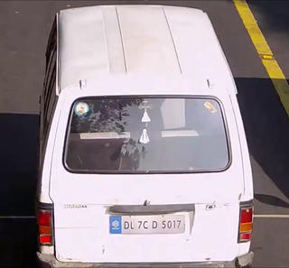
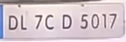
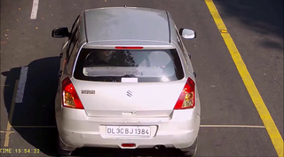
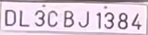
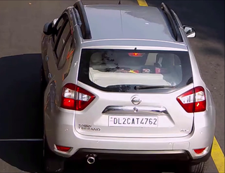
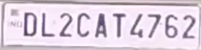
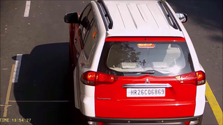

# FastALPR Vehicle & Plate Detection Gallery

| Event ID | Vehicle Snapshot | Plate Snapshot | Plate Read | Confidence | Time / Date | Status |
| :--- | :---: | :---: | :---: | :---: | :---: | :--- |
| `A01-261122111200-00` |  | *No Plate* | *None* | — | 11:12:00 2026-11-22 | Vehicle Only (Edge/Horizon) |
| `A01-261122111202-00` |  |  | **`DL7CD5017`** | 60.0% | 11:12:02 2026-11-22 | Verified Plate Event |
| `A01-261122111207-00` |  |  | **`DL3CBJ1384`** | 60.0% | 11:12:07 2026-11-22 | Verified Plate Event |
| `A01-261122111211-00` |  |  | **`DL2CAT4762`** | 60.0% | 11:12:11 2026-11-22 | Verified Plate Event |
| `A01-261122111217-00` |  |  | **`HR26CQ6869`** | 60.0% | 11:12:17 2026-11-22 | Verified Plate Event |
